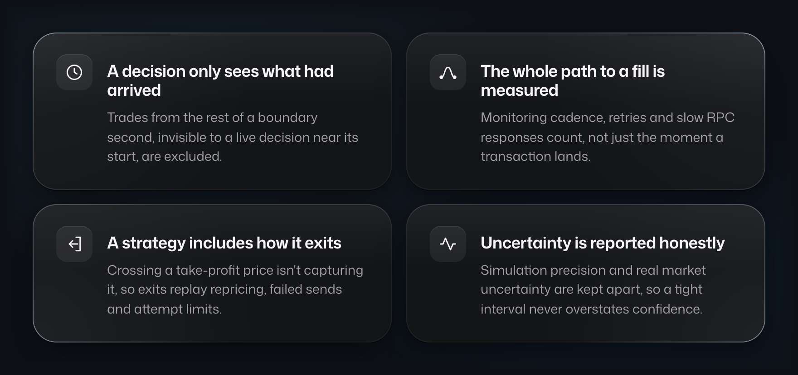
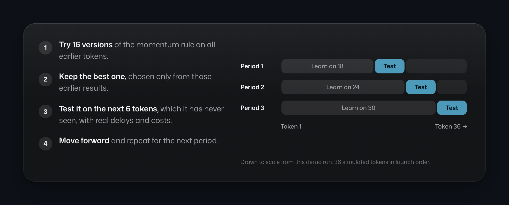
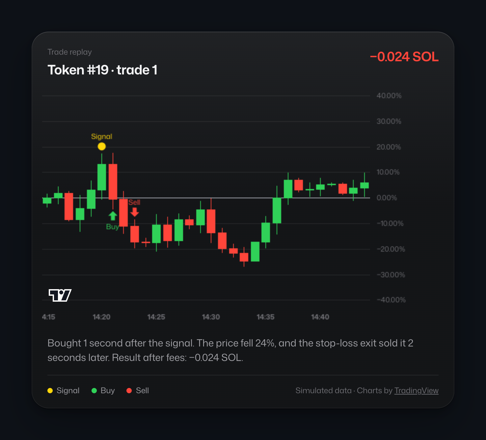
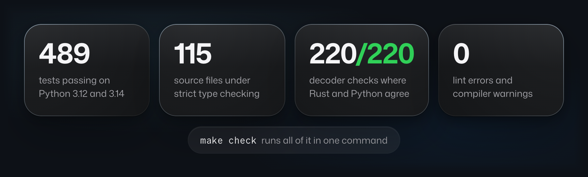

<picture>
  <source srcset="assets/hero.avif" type="image/avif">
  
</picture>

<br>

**PumpQuant tests trading ideas for newly launched Solana tokens the way they would really have played out: with the delays, fees, failed transactions and capital limits a live trade runs into.**

It began as a live trading system, and its early stage was profitable. When a later strategy's live results stopped matching its backtest, tracing the gap uncovered six mismatches between backtest and reality. PumpQuant was rebuilt so none of them can recur, and this repository is that engine.


## How the flaw was found

The live run and the backtest disagreed, so the run was reconciled trade by trade.


Each gap became a rule in the code:



The full account is in the [case study](docs/PARITY_CASE_STUDY.md).

## How a strategy is tested



A rule is tuned on earlier tokens, frozen, then tested on the tokens that launched next. Every candidate tried is recorded with hashes of the rule and the data, so a good result can be weighed against how many ideas were tried to find it.

## Every trade, replayed



Each trade replays the signal, the buy at the price then available, and the exit when its rule fired, with fees and failed attempts counted. This chart comes from the bundled demo, which runs on generated data.

## Scope

- **A research engine, not a trading bot.** The strategy that traded was retired by this engine, and no later candidate has yet cleared its gates.
- **The demo runs on generated data,** so anyone can run the whole method in a second. It shows how the method works, not whether a strategy makes money.
- **Private data stays private:** market archives, ledgers, wallets, balances and operating configuration are not included.
- **Provider-backed acquisition is included** but was not exercised for this release.
- **Licence:** none has been granted yet. Third-party notices are kept in [Provenance](docs/PROVENANCE.md).

## Run it

```sh
python -m pip install -e '.[dev,data,research,archive]'
pumpquant demo        # the whole pipeline on generated data, in about a second
pumpquant preview     # the dashboard above, at http://127.0.0.1:8765
make check            # lint, strict types, tests, Rust, and Python/Rust parity
```

## Inside




Go deeper: the design choices and their trade-offs in [Engineering decisions](docs/DECISIONS.md), the pipeline in [Architecture](docs/ARCHITECTURE.md), and everything verified for this release in [Status](docs/STATUS.md).
