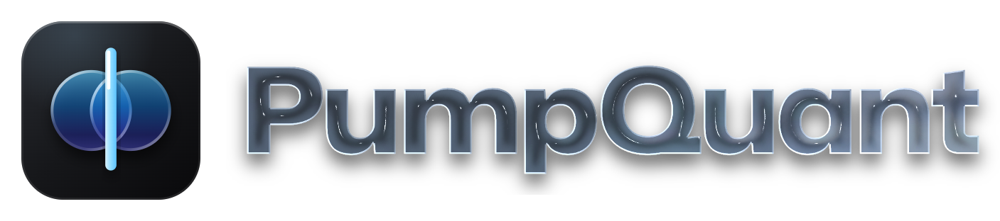
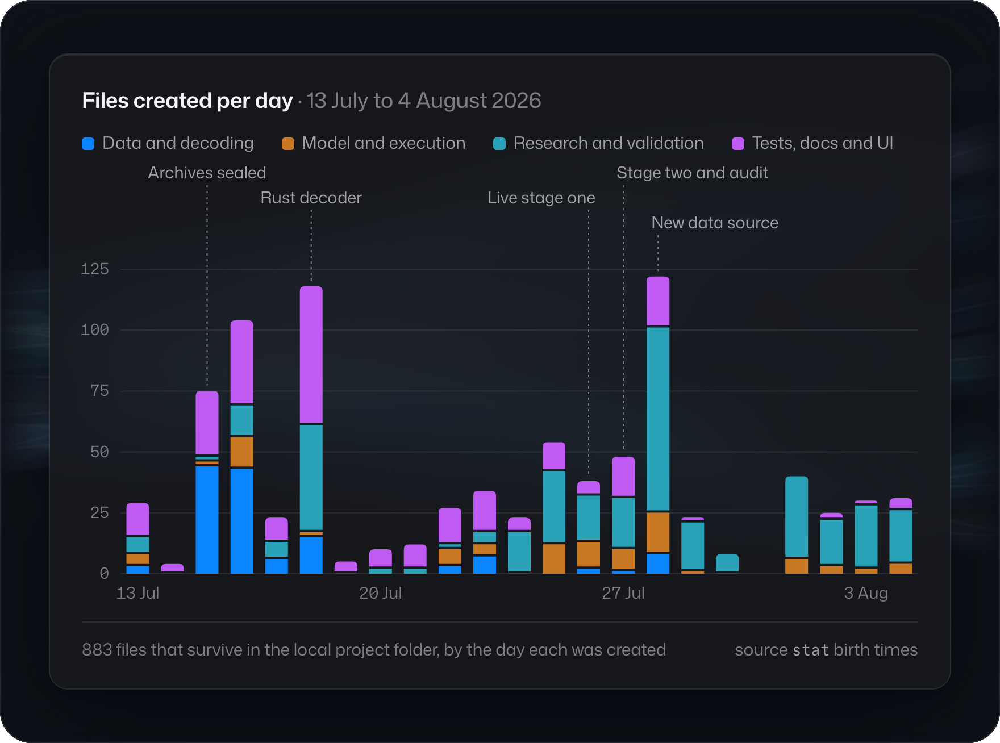

<p align="center">
  <picture>
    <source media="(prefers-color-scheme: light)" srcset="assets/lockup-light.png">
    
  </picture>
</p>

<h3 align="center">Backtesting engine for Pump.fun, Solana's token-launch market</h3>

<p align="center">
  <a href="#quick-start"><b>Quick start</b></a> ·
  <a href="#how-it-works"><b>How it works</b></a> ·
  <a href="#background"><b>Background</b></a> ·
  <a href="docs/PARITY_CASE_STUDY.md"><b>Case study</b></a> ·
  <a href="#roadmap"><b>Roadmap</b></a>
</p>

<p align="center">
  
  
  
  
  
</p>

<br>

<picture>
  <source srcset="assets/hero.avif" type="image/avif">
  
</picture>

<br>

PumpQuant is a backtesting engine for [Pump.fun](https://pump.fun), the Solana market where new tokens launch and trade. Backtests often look better than live trading, and PumpQuant is built to close that gap: it replays Pump.fun trades with the delays, fees and failed transactions a live trader would have faced, and tests each strategy only on data it has never seen.

It is for developers and researchers who build trading strategies for Pump.fun and need a backtest that holds up once the strategy trades live.

<table>
  <tr>
    <td width="50%" valign="top">
      <p><b>Exact pricing</b><br>Integer quotes that follow the official SDK formulas, rounding included.</p>
      <p><b>Realistic execution</b><br>Delays, retries, priority fees, failed transactions and shared capital.</p>
      <p><b>Strict decoding</b><br>Solana transactions and program events, with a Rust decoder checked against the Python one.</p>
    </td>
    <td width="50%" valign="top">
      <p><b>No look-ahead</b><br>Every feature uses only data that had arrived when the decision was made.</p>
      <p><b>Tested on unseen data</b><br>Each strategy is chosen on earlier tokens and tested on the ones that launched next, with every trial logged.</p>
      <p><b>A dashboard for every run</b><br>A local, read-only view of each test period and every trade.</p>
    </td>
  </tr>
</table>

**Built with** Python 3.12+ and Rust. DuckDB and PyArrow handle the market data, NumPy and the arch library the statistics, and two Rust crates decode transactions and run the parallel strategy search. The dashboard is a small local web app, served by Python's standard library and drawn with TradingView's Lightweight Charts.

**Data** PumpQuant works only on public Solana market data: the trades anyone can read from the chain. Wallet addresses are used only to measure trading flow, such as repeat buying or a creator selling, and never to identify people. It reads no personal or off-chain records, and this repository ships no real market data: the demo and the test fixtures are generated.

## Quick start

PumpQuant needs Python 3.12 or later. Install it with the data and research extras, then run the two examples and the dashboard:

```sh
pip install -e '.[data,research]'
python examples/periods.py
python examples/quote.py
pumpquant preview
```

Run on this repository, the session looks like this:

<picture>
  <source media="(prefers-color-scheme: light)" srcset="assets/terminal-light.png">
  
</picture>

<p align="center"><sub>The commands above, run on 4 November 2026; the output is pasted verbatim.</sub></p>

`examples/periods.py` prints the result of each test period in the demo. `examples/quote.py` calls the pricing engine directly. Its first half prices a 0.1 SOL buy on a new token (SOL is Solana's currency):

```python
from pumpquant.pricing.bonding_curve import pump_buy_exact_quote_in

SOL = 1_000_000_000  # lamports in one SOL; tokens have six decimals
FEES = {"protocol_fee_bps": 100, "creator_fee_bps": 0}  # a 1% fee
curve = {  # a new token's bonding curve
    "virtual_base_reserve": 1_073_000_000_000_000,
    "virtual_quote_reserve": 30 * SOL,
    "real_base_reserve": 793_100_000_000_000,
}

buy = pump_buy_exact_quote_in(gross_quote_amount=SOL // 10, **curve, **FEES)
print(f"0.1 SOL buys {buy.base_amount / 1e6:,.0f} tokens")
```

It prints `0.1 SOL buys 3,529,605 tokens`. The second half lets someone else's 1 SOL buy land first, and the same 0.1 SOL then buys 6.3% fewer tokens. That is why every replay in PumpQuant carries its real delay. `pumpquant demo` prints the demo's full report as JSON, including the rule each test period selected.

## The dashboard

`pumpquant preview` opens the dashboard on a demo run. It leads with the answer, then compares the test periods, shows how each one was tested, and replays any trade:

<p align="center">
  <picture>
    <source media="(prefers-color-scheme: light)" srcset="assets/scene-answer-light.png">
    
  </picture>
  <picture>
    <source media="(prefers-color-scheme: light)" srcset="assets/scene-periods-light.png">
    
  </picture>
  <picture>
    <source media="(prefers-color-scheme: light)" srcset="assets/scene-replay-light.png">
    
  </picture>
  <picture>
    <source media="(prefers-color-scheme: light)" srcset="assets/scene-method-light.png">
    
  </picture>
</p>

> [!NOTE]
> The demo runs on generated data: 36 simulated tokens, not market prices. The generator plants a weak momentum signal so the search has something to find. The demo shows how the method works, not whether a strategy makes money.

## How it works

PumpQuant follows the path a trade idea takes, from raw chain data to a verdict. Each stage is its own package, drawn here in reading order:

<picture>
  <source media="(prefers-color-scheme: light)" srcset="assets/architecture-light.png">
  
</picture>

Every event carries two times: when it happened on chain, and when a trader could first have seen it. Decisions and simulated fills use the second, so no fill can use a price the trader could not yet have known. The [architecture notes](docs/ARCHITECTURE.md) walk through each stage and the tests that hold it in place.

<details>
<summary><b>Project layout</b></summary>

```text
src/pumpquant/
  acquisition/   download and archive transactions, blocks and streams; BigQuery archiving
  decoding/      Solana wire format and Pump/PumpSwap program events
  state/         market state rebuilt in chain order, and token launch times
  features/      features computed at the decision boundary
  pricing/       exact quotes in integer protocol units
  execution/     replay with delays, retries, fees and shared capital
  research/      chronological strategy search and the trial ledger
  validation/    statistical and economic checks
  audits/        the audit of the retired live rule
  dashboard/     the read-only dashboard: server, pages and preview
  core/          records, hashing, file I/O and the demo data generator
  cli/           the pumpquant command
  demo.py        the demo run behind pumpquant demo and the preview
rust/
  pump-decoder-kernel/   transaction decoder, checked against Python
  growth-search/         parallel search kernels
tests/           mirrors src/pumpquant/
examples/        the Quick start scripts and the recorded demo output
scripts/         the Rust and Python decoder parity check
schemas/         the pinned Pump program event layouts
docs/            architecture, decisions, status, provenance and the case study
ROADMAP.md       what comes next
```

Each module's original name is in [docs/MODULE-MAP.md](docs/MODULE-MAP.md).

</details>

## Background

PumpQuant started as a live trading system. Its first stage was profitable, but a later strategy's live results fell short of its backtest. An audit of its 49 live round trips, each a buy and its sell, compared the backtest's expectations with what actually happened:

<picture>
  <source media="(prefers-color-scheme: light)" srcset="assets/audit-light.png">
  
</picture>

<p align="center"><sub>Figures from the historical audit, reported in the <a href="docs/PARITY_CASE_STUDY.md">case study</a>. They are not reproduced by this package.</sub></p>

A take-profit is a sell triggered when the price reaches its target. The price reached the target in ten trades, but only six sold there. The audit traced the gap to six differences between backtest and live trading. Among them, features had used trades from the whole second in which a decision was made, including ones a live trader could not yet have seen, and fill times had been measured from when an order was sent rather than from the decision. The engine now models each of these, and tests hold them in place. Under the corrected model the strategy lost money in all 16 test windows and was retired.

<details>
<summary><b>The six differences the audit found</b></summary>

| Difference | Why it mattered | What the engine does now |
| :-- | :-- | :-- |
| Features included the whole decision second | Backtest decisions saw trades a live decision could not | Records when data arrived separately from chain order, with a strict cut-off at the decision |
| Delay measured from send to processing | The full time from decision to fill was understated | Measures the complete entry and exit path, retries and slow network calls included |
| Retries and take-profit behaviour | A price reaching the target did not guarantee a sale there | Replays repricing, trigger checks, failed sends and real attempt limits |
| Continuous replay | Reactions were faster than the live monitoring allowed | Includes the live monitoring clock |
| Fee and structural exclusions | The live decisions differed from the modelled ones | Models the same population, including skipped decisions |
| Bootstrap intervals | Generated paths were read as independent market evidence | Reports simulation error separately from market uncertainty |

</details>

## History

PumpQuant was built locally from 13 July 2026: first the data archives and the decoder, then the research engine, two live stages, the audit and the rebuild it led to. It was first published to GitHub on 4 November 2026, and the [project history](docs/HISTORY.md) dates the time before from file creation times and the project's own logs. The files created each day, by area:

<picture>
  <source media="(prefers-color-scheme: light)" srcset="assets/timeline-light.png">
  
</picture>

<p align="center"><sub>From the creation dates of the files in the original folder. <a href="docs/HISTORY.md">The history</a> dates every phase and names its sources.</sub></p>

## Development

One command runs every check: ruff, mypy in strict mode on 112 source files, the 508 Python tests, the two examples, the 16 Rust tests with warnings as errors, and a parity check of the Rust decoder against the Python one on 220 fixtures.

```sh
make check
```

Its output on this repository:

<picture>
  <source media="(prefers-color-scheme: light)" srcset="assets/check-light.png">
  
</picture>

<p align="center"><sub>An excerpt of a real run on 4 November 2026; progress, compiler lines and the examples' output are left out. <a href="docs/STATUS.md">Status</a> lists every verified result, with exact versions.</sub></p>

## Roadmap

This is the first public release. [ROADMAP.md](ROADMAP.md) plans what follows in three steps: finish the release now, then build the product around the engine, then take tested strategies live and beyond Pump.fun.

<picture>
  <source media="(prefers-color-scheme: light)" srcset="assets/roadmap-light.png">
  
</picture>

- [ ] Publish the CI workflow, which runs the `make check` targets on Python 3.12, 3.13 and 3.14
- [ ] Tag `v0.1.0`, with a changelog, the wheel and the source archive
- [ ] Split the three modules over 1,500 lines and the 30 functions over 150 lines
- [ ] Test the event screens end to end (32% and 37% covered) and the BigQuery execute path (31%)
- [ ] Run clippy on both Rust crates and add reproducible benchmarks
- [ ] Desktop apps for Apple silicon Macs and for Windows, as the main way to use PumpQuant
- [ ] A guided strategy builder that creates and tests a strategy without code
- [ ] Data import from common file formats, and official chain data in one step
- [ ] Move a tested strategy to live trading in a few steps, with a live status view for each one

The [full roadmap](ROADMAP.md) says what done looks like for every item. More will be added as the work goes on.

## Documentation

- [History](docs/HISTORY.md): how the project was built, from the first files in July 2026 to this release
- [Architecture](docs/ARCHITECTURE.md): how the pipeline fits together
- [Engineering decisions](docs/DECISIONS.md): the main design choices and their trade-offs
- [Case study](docs/PARITY_CASE_STUDY.md): the audit that led to the rebuild
- [Status](docs/STATUS.md): what was verified for this release, its scope and its limits
- [Provenance](docs/PROVENANCE.md): what changed in this release, third-party notices and licences
- [Roadmap](ROADMAP.md): what comes next

## License

MIT. The bundled Lightweight Charts (Apache-2.0) and dashboard fonts (SIL Open Font License) keep their own licences, listed in [Provenance](docs/PROVENANCE.md).

<br>

<p align="center">
  <picture>
    <source media="(prefers-color-scheme: dark)" srcset="assets/icon-dark.png">
    
  </picture>
  <br>
  <sub>Built by <a href="https://github.com/Kobflish1">Elias Hassari</a></sub>
</p>
