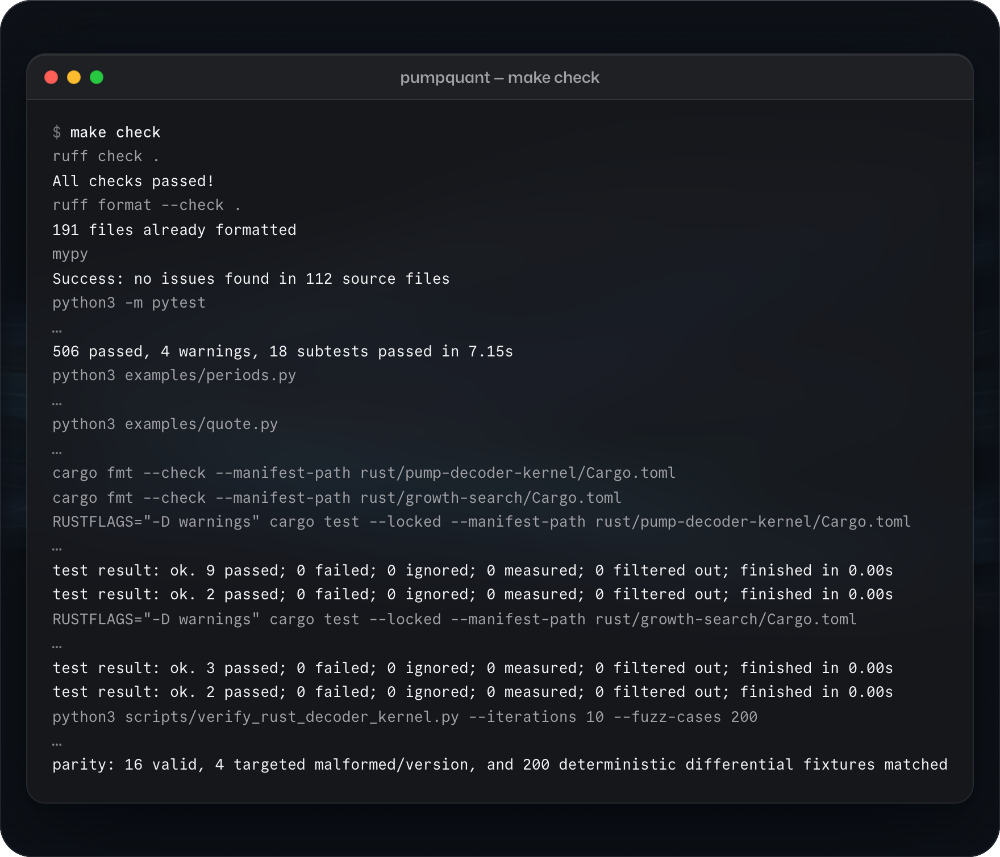

<p align="center">
  <picture>
    <source media="(prefers-color-scheme: dark)" srcset="assets/icon-dark.png">
    
  </picture>
</p>

<h1 align="center">PumpQuant</h1>

<h3 align="center">Backtesting engine for Pump.fun, Solana's token-launch market</h3>

<p align="center">
  <a href="#quick-start"><b>Quick start</b></a> ·
  <a href="#how-it-works"><b>How it works</b></a> ·
  <a href="#background"><b>Background</b></a> ·
  <a href="docs/PARITY_CASE_STUDY.md"><b>Case study</b></a>
</p>

<p align="center">
  
  
  
  
</p>

<br>

<picture>
  <source srcset="assets/hero.avif" type="image/avif">
  
</picture>

<br>

PumpQuant is a backtesting engine for [Pump.fun](https://pump.fun), the Solana market where new tokens launch and trade. Backtests often look better than live trading, and PumpQuant is built to close that gap: it replays Pump.fun trades with the delays, fees and failed transactions a live trader would have faced, and tests each strategy only on data it has never seen.

<table>
  <tr>
    <td width="50%" valign="top">
      <p><b>Exact pricing</b><br>Integer quotes that follow the official SDK formulas, rounding included.</p>
      <p><b>Realistic execution</b><br>Delays, retries, priority fees, failed transactions and shared capital.</p>
      <p><b>Strict decoding</b><br>Solana transactions and program events, with a Rust decoder checked against the Python one.</p>
    </td>
    <td width="50%" valign="top">
      <p><b>No look-ahead</b><br>Every feature uses only data that had arrived when the decision was made.</p>
      <p><b>Tested on unseen data</b><br>Each strategy is chosen on earlier tokens and tested on the ones that launched next, with every trial logged.</p>
      <p><b>A dashboard for every run</b><br>A local, read-only view of each test period and every trade.</p>
    </td>
  </tr>
</table>

## The dashboard

`pumpquant preview` opens the dashboard on a demo run. It leads with the answer, then compares the test periods, shows how each one was tested, and replays any trade:

<p align="center">
  <picture>
    <source media="(prefers-color-scheme: light)" srcset="assets/scene-answer-light.png">
    
  </picture>
  <picture>
    <source media="(prefers-color-scheme: light)" srcset="assets/scene-periods-light.png">
    
  </picture>
  <picture>
    <source media="(prefers-color-scheme: light)" srcset="assets/scene-replay-light.png">
    
  </picture>
  <picture>
    <source media="(prefers-color-scheme: light)" srcset="assets/scene-method-light.png">
    
  </picture>
</p>

> [!NOTE]
> The demo runs on generated data: 36 simulated tokens, not market prices. The generator plants a weak momentum signal so the search has something to find. The demo shows how the method works, not whether a strategy makes money.

## Quick start

PumpQuant needs Python 3.12 or later. Install it with the data and research extras, then run the two examples and the dashboard:

```sh
pip install -e '.[data,research]'
python examples/periods.py
python examples/quote.py
pumpquant preview
```

Run on this repository, the session looks like this:

<picture>
  <source media="(prefers-color-scheme: light)" srcset="assets/terminal-light.png">
  
</picture>

<p align="center"><sub>The commands above, run on 4 November 2026; the output is pasted verbatim.</sub></p>

`examples/periods.py` prints the result of each test period in the demo. `examples/quote.py` uses the pricing engine directly. It prices a 0.1 SOL buy on a new token (SOL is Solana's currency), then prices the same buy again after someone else's 1 SOL buy lands first:

```python
from pumpquant.pricing.bonding_curve import pump_buy_exact_quote_in

SOL = 1_000_000_000  # lamports
TOKEN = 1_000_000  # Pump.fun tokens have six decimals
FEES = {"protocol_fee_bps": 100, "creator_fee_bps": 0}  # a 1% fee

# A new token's bonding curve: virtual reserves, and the tokens it can still sell.
curve = {
    "virtual_base_reserve": 1_073_000_000_000_000,
    "virtual_quote_reserve": 30 * SOL,
    "real_base_reserve": 793_100_000_000_000,
}

first = pump_buy_exact_quote_in(gross_quote_amount=SOL // 10, **curve, **FEES)
fee = first.total_fee_quote / SOL
print(f"0.1 SOL buys {first.base_amount / TOKEN:,.0f} tokens, after a {fee:.5f} SOL fee")

# Someone else's 1 SOL buy lands first and moves the curve.
other = pump_buy_exact_quote_in(gross_quote_amount=SOL, **curve, **FEES)
curve = {
    "virtual_base_reserve": curve["virtual_base_reserve"] - other.base_amount,
    "virtual_quote_reserve": curve["virtual_quote_reserve"] + other.curve_quote_amount,
    "real_base_reserve": curve["real_base_reserve"] - other.base_amount,
}
late = pump_buy_exact_quote_in(gross_quote_amount=SOL // 10, **curve, **FEES)
fewer = 1 - late.base_amount / first.base_amount
print(f"one trade later it buys {late.base_amount / TOKEN:,.0f} tokens, {fewer:.1%} fewer")
```

Being one trade late costs 6.3% of the tokens, which is why every replay in PumpQuant carries its real delay. `pumpquant demo` prints the demo's full report as JSON, including the rule each test period selected.

## How it works

PumpQuant follows the path a trade idea takes, from raw chain data to a verdict. Each stage is its own package, drawn here in reading order:

<picture>
  <source media="(prefers-color-scheme: light)" srcset="assets/architecture-light.png">
  
</picture>

Every event carries two times: when it happened on chain, and when a trader could first have seen it. Decisions and simulated fills use the second, so no fill can use a price the trader could not yet have known. The [architecture notes](docs/ARCHITECTURE.md) walk through each stage and the tests that hold it in place.

<details>
<summary><b>Project layout</b></summary>

```text
src/pumpquant/
  acquisition/   download and archive transactions, blocks and streams; BigQuery archiving
  decoding/      Solana wire format and Pump/PumpSwap program events
  state/         market state rebuilt in chain order, and token launch times
  features/      features computed at the decision boundary
  pricing/       exact quotes in integer protocol units
  execution/     replay with delays, retries, fees and shared capital
  research/      chronological strategy search and the trial ledger
  validation/    statistical and economic checks
  audits/        the audit of the retired live rule
  dashboard/     the read-only dashboard: server, pages and preview
  core/          records, hashing, file I/O and the demo data generator
  cli/           the pumpquant command
  demo.py        the demo run behind pumpquant demo and the preview
rust/
  pump-decoder-kernel/   transaction decoder, checked against Python
  growth-search/         parallel search kernels
tests/           mirrors src/pumpquant/
examples/        the Quick start scripts and the recorded demo output
scripts/         the Rust and Python decoder parity check
schemas/         the pinned Pump program event layouts
docs/            architecture, decisions, status, provenance and the case study
```

Each module's original name is in [docs/MODULE-MAP.md](docs/MODULE-MAP.md).

</details>

## Background

PumpQuant started as a live trading system. Its first stage was profitable, but a later strategy's live results fell short of its backtest. An audit of its 49 live round trips, each a buy and its sell, compared the backtest's expectations with what actually happened:

<picture>
  <source media="(prefers-color-scheme: light)" srcset="assets/audit-light.png">
  
</picture>

<p align="center"><sub>Figures from the historical audit, reported in the <a href="docs/PARITY_CASE_STUDY.md">case study</a>. They are not reproduced by this package.</sub></p>

A take-profit is a sell triggered when the price reaches its target. The price reached the target in ten trades, but only six sold there. The audit traced the gap to six differences between backtest and live trading. Among them, features had used trades from the whole second in which a decision was made, including ones a live trader could not yet have seen, and fill times had been measured from when an order was sent rather than from the decision. The engine now models each of these, and tests hold them in place. Under the corrected model the strategy lost money in all 16 test windows and was retired.

<details>
<summary><b>The six differences the audit found</b></summary>

| Difference | Why it mattered | What the engine does now |
| :-- | :-- | :-- |
| Features included the whole decision second | Backtest decisions saw trades a live decision could not | Records when data arrived separately from chain order, with a strict cut-off at the decision |
| Delay measured from send to processing | The full time from decision to fill was understated | Measures the complete entry and exit path, retries and slow network calls included |
| Retries and take-profit behaviour | A price reaching the target did not guarantee a sale there | Replays repricing, trigger checks, failed sends and real attempt limits |
| Continuous replay | Reactions were faster than the live monitoring allowed | Includes the live monitoring clock |
| Fee and structural exclusions | The live decisions differed from the modelled ones | Models the same population, including skipped decisions |
| Bootstrap intervals | Generated paths were read as independent market evidence | Reports simulation error separately from market uncertainty |

</details>

## Development

One command runs every check: ruff, mypy in strict mode on 112 source files, the 506 Python tests, the two examples, the 16 Rust tests with warnings as errors, and a parity check of the Rust decoder against the Python one on 220 fixtures.

```sh
make check
```

Its output on this repository:

<picture>
  <source media="(prefers-color-scheme: light)" srcset="assets/check-light.png">
  
</picture>

<p align="center"><sub>An excerpt of a real run on 4 November 2026; progress and compiler lines are left out. <a href="docs/STATUS.md">Status</a> lists every verified result, with exact versions.</sub></p>

## Documentation

- [Architecture](docs/ARCHITECTURE.md): how the pipeline fits together
- [Engineering decisions](docs/DECISIONS.md): the main design choices and their trade-offs
- [Case study](docs/PARITY_CASE_STUDY.md): the audit that led to the rebuild
- [Status](docs/STATUS.md): what was verified for this release, its scope and its limits
- [Provenance](docs/PROVENANCE.md): what changed in this release, third-party notices and licences

<br>

<p align="center">
  <picture>
    <source media="(prefers-color-scheme: dark)" srcset="assets/icon-dark.png">
    
  </picture>
  <br>
  <sub>Built by <a href="https://github.com/Kobflish1">Elias Hassari</a></sub>
</p>
