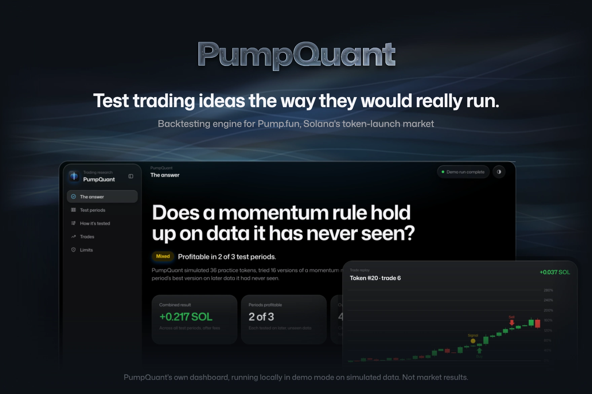
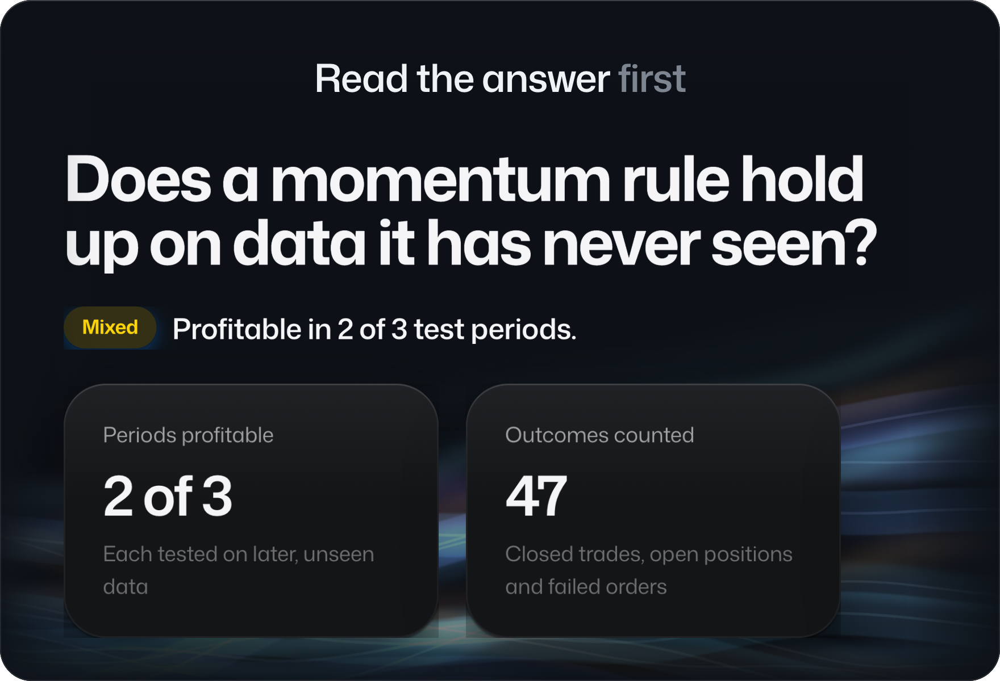
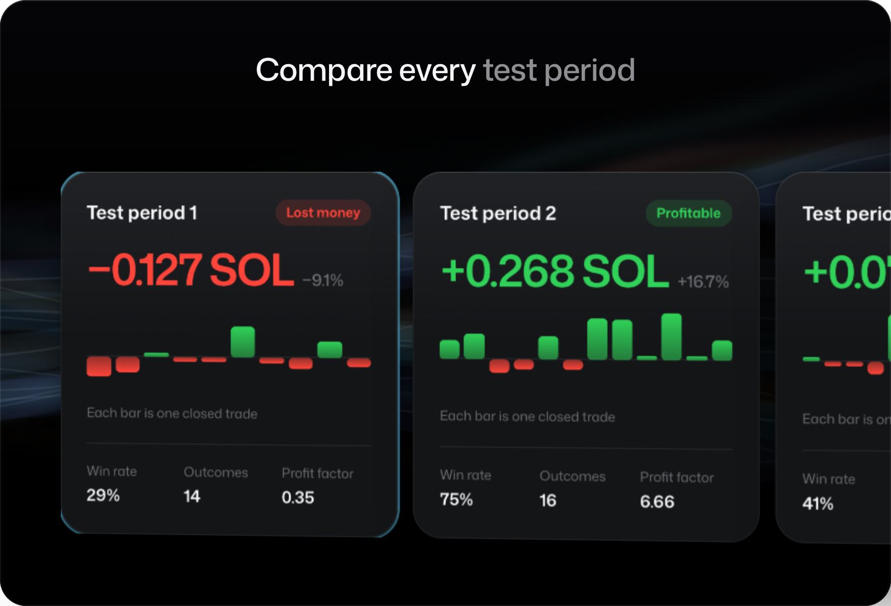
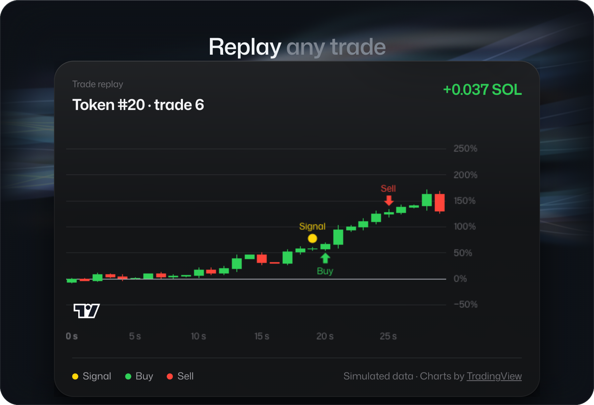
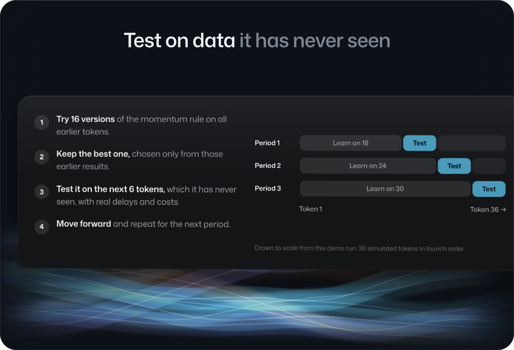
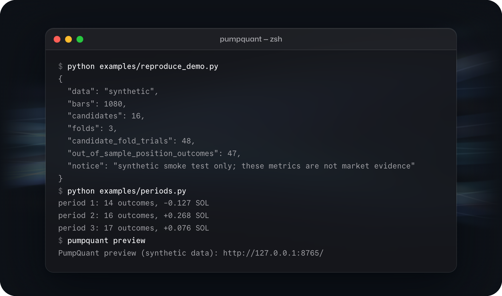
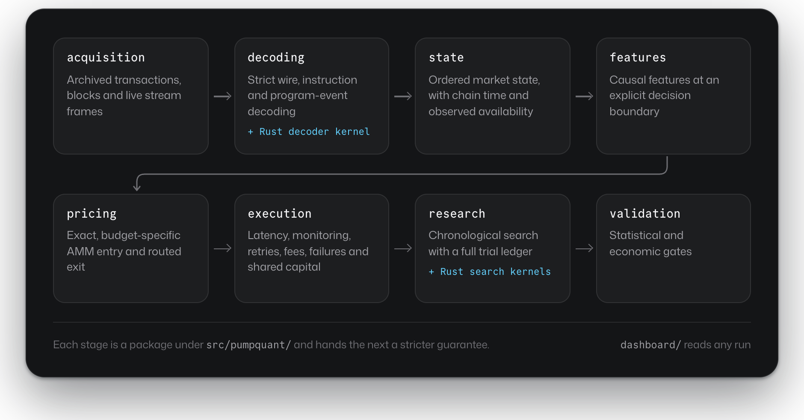
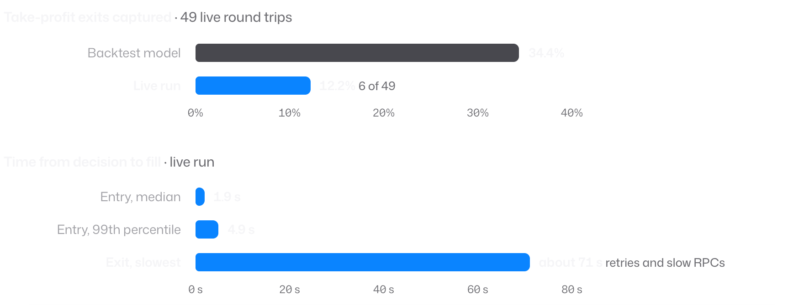

<p align="center">
  <picture>
    <source media="(prefers-color-scheme: dark)" srcset="assets/icon-dark.png">
    
  </picture>
</p>

<h3 align="center">Backtesting and research engine for Pump.fun tokens on Solana</h3>

<p align="center">
  <a href="#quick-start"><b>Quick start</b></a> ·
  <a href="#how-it-works"><b>How it works</b></a> ·
  <a href="#background"><b>Background</b></a> ·
  <a href="docs/PARITY_CASE_STUDY.md"><b>Case study</b></a>
</p>

<p align="center">
  
  
  
  
</p>

<br>

<picture>
  <source srcset="assets/hero.avif" type="image/avif">
  
</picture>

<br>

PumpQuant replays every [Pump.fun](https://pump.fun) trade with the latency, fees and failed transactions a live trader would have faced, and tests each strategy only on data it has never seen.

<table>
  <tr>
    <td width="50%" valign="top"><b>Exact pricing</b><br>Integer quotes that match the Pump and PumpSwap programs, rounding included.</td>
    <td width="50%" valign="top"><b>No look-ahead</b><br>Every feature uses only data that had arrived when the decision was made.</td>
  </tr>
  <tr>
    <td valign="top"><b>Realistic execution</b><br>Latency, retries, priority fees, failed transactions and shared capital.</td>
    <td valign="top"><b>Walk-forward search</b><br>Chronological train and test periods, with every trial logged.</td>
  </tr>
  <tr>
    <td valign="top"><b>Strict decoding</b><br>Solana transactions and program events, with a Rust decoder checked against the Python one.</td>
    <td valign="top"><b>A dashboard for every run</b><br>A local, read-only view of each period and every trade.</td>
  </tr>
</table>

## The dashboard

`pumpquant preview` opens the dashboard on a demo run. It leads with the answer, then lets you compare the test periods, see how each one was tested, and replay any trade.

<p align="center">
  <picture>
    <source media="(prefers-color-scheme: light)" srcset="assets/scene-answer-light.png">
    
  </picture>
  <picture>
    <source media="(prefers-color-scheme: light)" srcset="assets/scene-periods-light.png">
    
  </picture>
  <picture>
    <source media="(prefers-color-scheme: light)" srcset="assets/scene-replay-light.png">
    
  </picture>
  <picture>
    <source media="(prefers-color-scheme: light)" srcset="assets/scene-method-light.png">
    
  </picture>
</p>

> [!NOTE]
> The demo runs on generated data: 36 simulated tokens, not market prices. It shows how the method works, not whether a strategy makes money.

## Quick start

```sh
pip install -e '.[dev,data,research,archive]'
python examples/reproduce_demo.py
python examples/periods.py
pumpquant preview
```

<picture>
  <source media="(prefers-color-scheme: light)" srcset="assets/terminal-light.png">
  
</picture>

The demo generates 36 tokens, searches 16 versions of a momentum rule, and tests each period's best version on the tokens that launched next. `examples/periods.py` reads the same run from Python:

```python
from pumpquant.demo import run_demo

run = run_demo(tokens=36, seed=7)
for fold in run.report.folds:
    result = fold.test_backtest
    pnl = result.total_quote_pnl
    print(f"period {fold.number + 1}: {result.position_outcomes} outcomes, {pnl:+.3f} SOL")
```

`pumpquant demo` prints the full report as JSON, including the rule each period selected.

## How it works

PumpQuant follows the path a trade idea takes, from raw chain data to a verdict. Each stage is a package, and each hands the next a stricter guarantee.

<picture>
  <source media="(prefers-color-scheme: light)" srcset="assets/architecture-light.png">
  
</picture>

The engine keeps two clocks. An event's place in chain order and the moment a trader could have seen it answer different questions, so a simulated fill can never use prices from before a delayed observation. The [architecture notes](docs/ARCHITECTURE.md) walk through each stage and the tests that hold it in place.

<details>
<summary><b>Project layout</b></summary>

```text
src/pumpquant/
  acquisition/   download and archive transactions, blocks and streams
  decoding/      Solana wire format and Pump/PumpSwap program events
  state/         market state rebuilt in chain order
  features/      features computed at the decision boundary
  pricing/       exact quotes in integer protocol units
  execution/     replay with latency, retries, fees and shared capital
  research/      walk-forward search and the trial ledger
  validation/    statistical and economic checks
  audits/        the historical investigations
  dashboard/     the read-only dashboard server and preview
rust/
  pump-decoder-kernel/   transaction decoder, checked against Python
  m4-growth-search/      parallel search kernels
```

The old-to-new module map is in [docs/MODULE-MAP.md](docs/MODULE-MAP.md).

</details>

## Background

PumpQuant started as a live trading system. Its early stage was profitable, but a later strategy's live results drifted from its backtest. A trade-by-trade audit of 49 live round trips showed where the backtest had been too kind:

<picture>
  <source media="(prefers-color-scheme: light)" srcset="assets/audit-light.png">
  
</picture>

<p align="center"><sub><i>Figures from the historical audit, reported in the <a href="docs/PARITY_CASE_STUDY.md">case study</a>. They are not reproduced by this package.</i></sub></p>

Ten positions crossed their take-profit target, but only six exits were captured. Features had used trades from the whole decision second, and fill time had been measured from send rather than from the decision. The engine was rebuilt so none of these can recur. Under the corrected model the strategy lost money in all 16 test windows and was retired.

<details>
<summary><b>The six differences the audit found</b></summary>

| Difference | Why it mattered | What the engine does now |
| :-- | :-- | :-- |
| Features included the whole boundary second | Backtest decisions saw trades a live decision could not | Separates when data arrived from chain order, with a strict causal boundary |
| Latency measured from send to processing | The full decision-to-fill path was understated | Measures the complete entry and exit path, retries and slow RPCs included |
| Retries and take-profit behaviour | A price crossing did not guarantee a captured exit | Replays repricing, trigger checks, failed sends and real attempt limits |
| Continuous replay | Reactions were faster than the live monitoring allowed | Includes the live monitoring clock |
| Fee and structural exclusions | The live decisions differed from the modelled ones | Models the same population, including skipped decisions |
| Bootstrap intervals | Generated paths were read as independent market evidence | Reports simulation error separately from market uncertainty |

</details>

## Development

```sh
make check
```

This runs ruff, mypy in strict mode on 115 source files, the 489 Python tests, the 16 Rust tests, and a parity check of the Rust decoder against the Python one on 220 fixtures. [Status](docs/STATUS.md) lists the latest verified results, with exact versions.

## Documentation

- [Architecture](docs/ARCHITECTURE.md): how the pipeline fits together
- [Engineering decisions](docs/DECISIONS.md): the main design choices and their trade-offs
- [Case study](docs/PARITY_CASE_STUDY.md): the audit that led to the rebuild
- [Status](docs/STATUS.md): what was verified for this release, and what is out of scope

## License

License terms have not been set yet. Third-party notices are listed in [Provenance](docs/PROVENANCE.md).

<br>

<p align="center">
  <picture>
    <source media="(prefers-color-scheme: dark)" srcset="assets/icon-dark.png">
    
  </picture>
  <br>
  <sub>Built by <a href="https://github.com/Kobflish1">Elias Hassari</a></sub>
</p>
