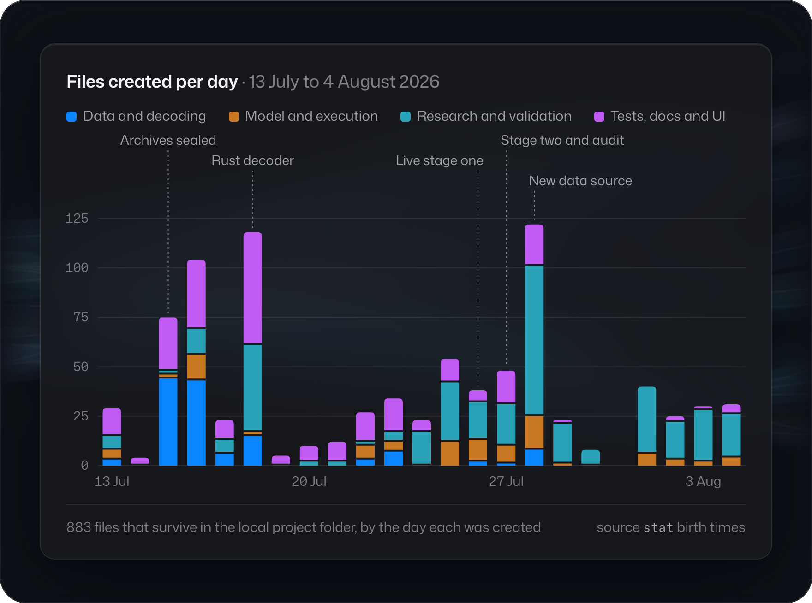

# History

PumpQuant is a research engine for Pump.fun, the Solana launchpad where new tokens trade first on a bonding curve (a price formula set by the program) and later on PumpSwap, an automated market maker. It archives the raw chain data, decodes it, rebuilds what a trader could have known at each moment, prices trades with the protocol's exact integer arithmetic, and tests strategies in time order against the full cost of execution. It also traded live, with deliberately small amounts.

It was built locally from 13 July 2026, in one folder on Elias's Mac, with rented cloud servers for the heavy jobs. The public GitHub history starts on 4 November 2026, when a curated release was first published. This document is the record of the period before that. Every date below comes from file creation times, the dated documents inside the project, or the logs of the working sessions; [the evidence map](#evidence) says where each one came from.

<picture>
  <source media="(prefers-color-scheme: light)" srcset="../assets/timeline-light.png">
  
</picture>

The 883 files that survive in the local folder, by the day each was created. Bulk data and generated artifacts were deleted during the project and are not counted.

## At a glance

By the last research change on 4 August 2026, 23 days after the first file, the local folder held:

- **About 231,000 lines of Python** in 93 package modules, 318 research and operations scripts and 158 test files;
- **939 Python test functions,** plus 16 Rust tests and 4 Node test files for the live execution code;
- **three Rust crates:** an archive reader, a strict transaction decoder and parallel search kernels;
- **124 frozen experiment configurations** and 82 dated research and decision documents;
- **36 systemd units** that ran the archive and research pipelines on rented cloud servers;
- **archives covering about 850 million Pump.fun and PumpSwap transactions,** sealed with checksums and manifests.

The working style shows in the documents: experiments were registered before their results were read, a chronological holdout stayed locked, and every live trade was reconciled against the chain.

## How it was built

Elias set the goals, made the research and risk decisions, approved every live action and every billable step, and challenged results that did not add up. The work was done with AI coding assistants in the project folder under that direction, and the 9,761-line working log records it. A local Git repository was created on 18 July for handoffs between sessions. It held two commits, never had a remote, and no longer exists.

## Phases

All times are local (Europe/Rome).

### 1. Foundations · 13 July

The first 29 files were created on 13 July, starting at 15:20: the event and bar schemas, causal features, an execution replay, walk-forward search, metrics, a command line and their tests. The founding decision is in the README and architecture notes started that day. Pump.fun has no order book, so PumpQuant represents depth as an executable quote surface computed from reserves and fees, at any order size, and never pretends to have bids and asks it cannot see.

### 2. Data acquisition · 13 to 17 July

The first data source was Google BigQuery's public Solana dataset. A planner estimated every query with a free dry run before anything ran, and a coordinator refused any plan without a byte cap. The approved 30-day window, 7 June to 7 July 2026, came in at about 0.97 TiB, inside the 1 TiB free quota. On 15 July it was fully reconciled: 30 query jobs, 850,003,142 rows, 2,611 Parquet shards.

BigQuery rows lack the full transactions, so the next step was the Old Faithful block archive. A Rust crate written on 15 July read it through the open-source Jetstreamer library, and a fleet of cloud workers filled the gap at the end of the range over RPC (the nodes that serve Solana data). The sealed archive covers 6,484,392 consecutive slots: 850,220,332 Pump.fun and PumpSwap transactions in about 1.5 TB, audited on 16 July.

Before trusting it, a one-hour pilot was checked end to end. The archive held every one of the 8,942 blocks produced in that hour and 11,504,206 transactions, and all 939,568 discovery signatures were found in it, with no decode failures. A separate one-hour live stream capture recorded 8,426,549 frames with no gap. 15 and 16 July were the busiest days of this phase: 75 and 104 new files.

### 3. Decoding and market state · 15 to 18 July

Decoding moves from bytes to meaning in steps: Solana wire format, raw instructions, the intent of each instruction, its accounts named from the official program definition, and the program's own event logs. A schema lock pins the upstream protocol documentation by hash.

On top of that, the engine rebuilds AMM state in chain order and records, for every event, both its chain time and the time a trader could first have seen it. Pricing uses integer arithmetic that follows the official SDK formulas: Pump SDK 1.36.0 for the bonding curve and PumpSwap SDK 1.18.0, with every fee component kept separate.

On 18 July the decoder's hottest primitive was ported to Rust as `pump-decoder-kernel`: a strict, dependency-free parser for legacy and v0 transactions. It was written alongside a parity script that runs the Python and Rust decoders on the same valid, malformed and randomly mutated inputs and requires identical answers. The reason was measured, not assumed: the Python decoder had kept one core of a 16-core server busy while the others idled.

### 4. Research and search · 16 to 24 July

Search is chronological and token-level: choose on tokens that launched earlier, test on the ones that launched next, with an embargo between them and an append-only ledger of every candidate tried, including the losers. A distributed version split candidates across machines and merged their ledgers deterministically (16 July).

The early results were negative and were recorded as such. A 135-candidate event screen across 15 families found no candidate positive out of sample. Four research-derived families with 288 candidates were then frozen before any outcome was read, against 15 gates that ended in exact integer fills and a shared small-wallet replay.

On 18 July an audit caught a construction error before it could mislead: the bonding-curve data had 11,276,887 rows but none of the state-continuity rows the features needed, because predecessor state had not been rebuilt. The correction was registered as a narrow rerun and the original outputs were kept for audit. A provenance audit the same day separated what the cited papers supplied from what PumpQuant had invented.

From 20 to 24 July the work widened: a literature and strategy inventory, an opportunity atlas of what happens to every launch, a tail-exit study whose evidence covers 276,295 out-of-sample trades for 40 ideas, and two more data paths (an SQD exporter and a Bitquery downloader) on 23 July. On 24 July a Rust crate using Rayon took over the largest search, ranking simple rules by geometric account growth across five execution scenarios.

### 5. The dashboard · 19 to 23 July

A read-only API over sealed run manifests came first (19 July), then a desktop-grade web terminal (21 July) with headline metrics, equity and trade charts, a research queue and a fill-by-fill ledger. The written rule was that a missing number shows as "Not reported" and the interface never invents evidence. Lightweight Charts was added on 22 July.

### 6. Calibration and live trading · 25 to 27 July

Before any real order, the execution model was calibrated on mainnet with tiny signed transactions: fees, landing times and failure modes, linked to their signatures (25 and 26 July). Routes to two RPC providers were benchmarked, a universal priority-fee controller was built, and the frozen rule passed its one-shot holdout of 155 trades.

The strategy then ran in stages, each meant to double a small, dedicated wallet. The live listener ran in shadow mode first, with broadcasting physically disabled, and went live late on 26 July.

**Stage one completed on 27 July with a net gain,** about six hours after its first trade. 53 positions were opened and closed. All 136 submitted transactions were recovered from the chain, and their balance changes reconcile with the wallet to the last unit. The median trade lost and a few large winners carried the result, as the design intended. The post-trade audit found one real defect: a take-profit retry after a failed send could sell below its target. Every such retry now re-prices before it is sent.

### 7. The audit · 27 July

Stage two used a new rule, found with a rank-correlation screen of 126,000 feature and exit combinations, for small, thinly traded tokens. Its historical test claimed a 99.51% chance of reaching the stage target. Live, it did much worse, and the run was stopped, flat, the same day. When the follow-up drifted into routine safeguards, Elias insisted that six take-profits in 47 trades, about a 0.075% event under the model, meant the model and live trading differed, and turned the work into this audit.

The audit reconciled every finalised live trade: 49 round trips, 11 winners. The model expected about 34.4% of trades to exit at take-profit; the price reached the target in 10 trades and only 6 sold there. Under the model's own rate, six or fewer would happen about 0.04% of the time. Fees were only 6.7% of the loss, so they were not the cause. The stage closed with a loss of about a third of its starting balance.

The cause was a set of differences between the backtest and live trading, each now documented:

- features included the whole decision second, so the backtest saw trades a live decision could not yet have seen;
- latency was measured from send to processing, not from decision to fill (live entries took about 1.9 s at the median);
- retries and the live 200 ms monitoring clock were not modelled, so a price touching the target was counted as a sale;
- the live fee gate and population filters differed from the modelled ones;
- the 99.51% figure treated simulated bootstrap paths as independent market evidence.

Replayed with the live checkpoint and latency, the historical win rate fell to about 23%, close to the live 22.4%. With the full execution model, the rule lost money in all four periods and all 16 chronological test windows, and it was retired. The same day produced the documents that govern the rest of the project: a quant research standard, an audit of every requirement in the working log, and a single current-state file.

### 8. The rebuild · 27 July to 4 August

The engine was rebuilt around what the audit found. Decisions now start from the observed arrival time. Execution replay covers the whole lifecycle: entry, monitoring cadence, trigger, retries with repricing, paid failures, timeout and the route after migration. Outcomes are priced at each exact budget instead of scaled from a small one, and simulation error is reported apart from market uncertainty.

The research continued under those rules and kept finding its own mistakes. Late on 27 July a sweep of all 519,987 Pump.fun launches in four periods found no robust rule, and also found that an earlier feature family had included a field known only after the outcome; that family was retired as discovery evidence. On 28 July the project switched to PumpAPI's hourly archives after they matched the old source in 379 of 379 overlapping events at atomic precision, and around then the folder was cut from 106.77 GB to 2.62 GB. With 122 new files, 28 July was the busiest day of the project.

From 29 July to 4 August came a joint profit optimizer, an exact multi-budget outcome cube of 1,737,988 decision states, and a restart that labels outcomes without choosing exits first. Several candidates were frozen and then tested on days they had never seen or under exact execution replay. None survived, and each rejection is recorded with its reason. The last research change is dated 4 August. On 8 August, with Elias's approval, the live wallet was emptied to his own wallet. Nothing was left running.

### 9. The portfolio release · 29 October to 4 November

The release work started on 29 and 30 October. The original source was curated into a package grouped by stage (acquisition, decoding, state, features, pricing, execution, research, validation), with the command line split, about 9,900 lines of code that could not run outside the private setup removed, and duplicated helpers merged. Several real defects were fixed along the way. The dashboard was redesigned through several iterations on 30 and 31 October into a plain-language overview and a full research terminal. Private data, ledgers, wallet material and operating configs were left out.

On 4 November the release passed its checks on Python 3.12, 3.13 and 3.14: 506 tests, ruff and strict mypy on 112 source files, both Rust crates built with warnings as errors, and Python/Rust decoder parity on 220 fixtures. It was published to GitHub at 00:47 that night, followed by further commits the same day.

## Timeline

| Date | Milestone |
| :-- | :-- |
| 13 July | First files: schemas, features, execution replay, search, tests |
| 15 July | BigQuery window reconciled: 850,003,142 rows in 2,611 shards; Rust archive reader |
| 16 July | Old Faithful archive sealed: 850,220,332 transactions; distributed search |
| 18 July | Rust decoder kernel with Python parity checks; data-construction error caught; 630 tests |
| 19 to 22 July | Read-only dashboard API and research terminal |
| 24 July | Rust search kernels for geometric-growth ranking |
| 25 to 26 July | Mainnet execution calibration; holdout passed; live in shadow, then broadcasting |
| 27 July | Stage one completed with a net gain, every transaction reconciled |
| 27 July | Stage two stopped; audit traces the backtest-to-live gap; rule retired |
| 27 to 28 July | 519,987-launch sweep; outcome leak found and retired; new data source verified |
| 4 August | Last research change: exact multi-budget cube, failure audit, restart |
| 8 August | Live wallet emptied with the owner's approval; nothing left running |
| 30 October | Curated release package created; dashboard redesign |
| 4 November | First publication on GitHub, 506 tests passing |

## Where it stands

PumpQuant is a research engine with a documented live record: one profitable stage, one failed stage, and the audit that explains the difference. It holds no validated strategy and is not authorised to trade. What lasts is the engine: an archive and decoder that agree across two languages, exact pricing, an execution replay that now models what live trading taught it, and tests that hold those rules in place. Plans for what comes next are in [ROADMAP.md](../ROADMAP.md).

## Evidence

The main sources are the file creation times, `README.md`, `HANDOFF-archive-2026-07-21-1523.md`, `HANDOFF.md`, `docs/CURRENT_PROJECT_STATE.md`, `docs/FIRST_STAIR_POST_EXECUTION_AUDIT_V1.md`, `docs/SECOND_STAIR_RESEARCH_V1.md` and the working log `CONVERSATION.MD`, all in the original folder, and [the parity case study](PARITY_CASE_STUDY.md) and [status](STATUS.md) here.
