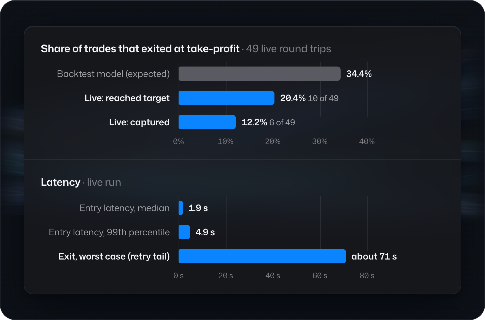

# When the backtest and live trading disagreed

PumpQuant traded live before it was a research engine. Its first stage was profitable. A later strategy, built to trade small, thinly traded tokens, did worse live than its backtest said it would. This is the account of the audit that found out why, and of what changed in the engine as a result.

It is a cleaned-up account of a private, internal audit. The ledgers, transaction signatures, balances, wallet addresses and market archives behind it are not part of this repository, so the figures below are the audit's own reports. This package does not reproduce them.

## What the audit found

The audit reconciled every finalised live trade of that strategy: 49 round trips, each a buy and its sell. Eleven made money and 38 lost.

The backtest had expected about 34.4% of trades to exit at their take-profit, the sell that is triggered when the price reaches its target. Live, the price reached the target in 10 of the 49 trades, and only 6 actually sold there:

<picture>
  <source media="(prefers-color-scheme: light)" srcset="../assets/audit-light.png">
  
</picture>

If the backtest's 34.4% had been right, six or fewer take-profit exits in 49 trades would have had a probability of about 0.0412%. That figure rests on the model's own rate and on treating trades as independent, so it flagged a real discrepancy; it does not by itself say which assumption was wrong.

The live delays were also longer than the backtest assumed. Buying took about 1.9 seconds at the median and 4.9 seconds at the 99th percentile. Selling had a long tail of retries and slow network calls that reached roughly 71 seconds. These describe that historical run, not today's services.

## Why the backtest was too kind

The audit traced the gap to six differences between the backtest and live trading:

| Difference | Why it mattered | What the engine does now |
| :-- | :-- | :-- |
| Features included the whole decision second | Backtest decisions saw trades that a live decision could not yet have seen | Records when data arrived separately from chain order, with a strict cut-off at the decision |
| Delay measured from send to processing | The full time from decision to fill was understated | Measures the complete entry and exit path, retries and slow network calls included |
| Retries and take-profit behaviour | A price reaching the target did not guarantee a sale there | Replays repricing, trigger checks, failed sends and real attempt limits |
| Continuous replay | The backtest reacted faster than the live monitoring could | Includes the live monitoring clock |
| Fee and structural exclusions | The live decisions differed from the modelled ones | Models the same population, including skipped decisions |
| Bootstrap intervals | Generated paths were read as independent market evidence | Reports simulation error separately from market uncertainty |

## What happened next

With the clock and execution corrected, the strategy was replayed again. It lost money on average in all four periods inspected, and in all 16 chronological test windows, so it was retired. Later research found real structure in the data and some promising candidates, but none of them was validated as a strategy that could trade.

## What this repository can show

The tests check the behaviour the audit called for: a fill after a delayed observation never uses an earlier price, features unavailable at a training cut-off are excluded, failed entry attempts are counted and paid for, the two published PumpSwap buy conventions are kept apart, and wallet validation needs budgets that were actually replayed. The demo runs the same search and replay path on generated data.

These tests show how the engine behaves on controlled inputs. They do not rebuild the private audit, prove a market edge, or validate every historical research claim. What lasts is a testable contract for execution, and a record of why the earlier model failed.
